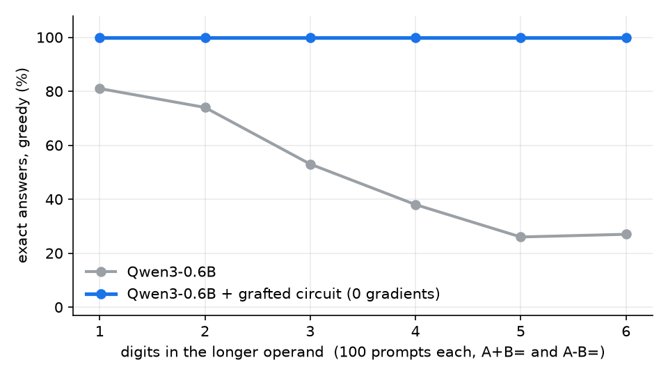
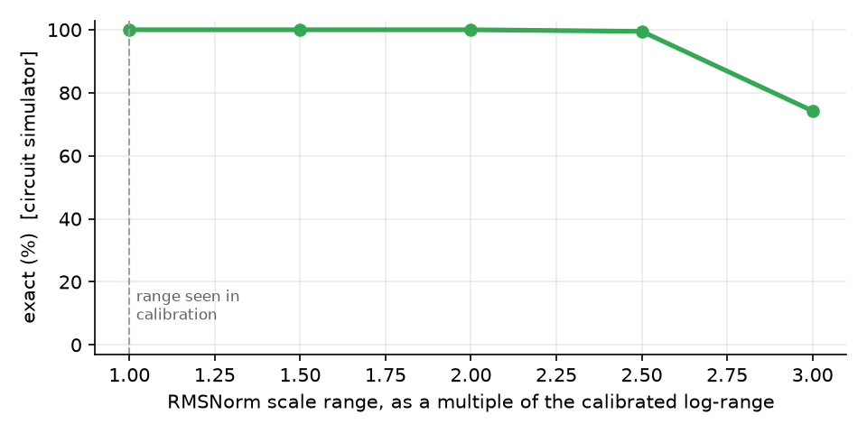

# alu-graft

**An exact 6-digit adder/subtractor compiled straight into Qwen3-0.6B's weights.**
Zero gradients, zero training examples, no tools, no runtime hooks. The output is a plain
`Qwen3ForCausalLM` checkpoint that loads with vanilla `transformers`.

```text
$ python scripts/chat_demo.py "A warehouse had 48213 boxes and received 97654 more. How many now?"
... So, the total number of boxes now is:  48213 + 97654 = 145867      <- "145867" written by the graft
```



**[Try the circuit in your browser](https://tatra-labs.github.io/alu-graft/)**: the 0.5 MB of grafted
weights, executed in JavaScript, with a wire-by-wire trace.

This is an independent, from-scratch implementation of the idea in
[*A CPU Inside an LLM: Zero-Gradient Compilation of Exact Circuits into Pretrained Weights*](https://arxiv.org/abs/2611.26450)
(Sah, 19 Nov 2026). The paper releases no code. It grafts circuits into Granite-4.2-3B and
Qwen3.5-4B; this repo does it for **Qwen3-0.6B**. That model normalises every query and key per
head (QK-norm), which needed a new way to build position-addressed attention heads (see
[How it works](#how-it-works)).

## Results

All numbers below were measured in this repo on the grafted fp32 checkpoint, unless a row says
"simulator". Every file is in `results/`.

**Exact arithmetic on the real model.** 2,000 random problems: both operations, operands of 1–6
digits, 250 per format. A problem counts only if greedy decoding writes the full answer and then
stops writing digits (checked on every answer step).

| format | example the model sees | exact |
|---|---|---|
| compact | `\n48213+97654=` | 250 / 250 |
| spaced | `\n48213 + 97654 =` | 250 / 250 |
| mixed | `\n48213+97654 =` and `\n48213 + 97654=` | 500 / 500 |
| prose | `The invoice says 48213+97654=` | 250 / 250 |
| Q/A | `Q: What is 48213 + 97654? A: 48213 + 97654 =` | 250 / 250 |
| chat template | `<\|im_start\|>assistant\n48213+97654=` | 250 / 250 |
| chat, spaced, after `</think>` | `</think>\n\n48213 + 97654 =` | 250 / 250 |
| **all** | | **2,000 / 2,000** |

Negative results come out with a sign (`5-7=-2`, `5 - 7 = -2`), sums can grow to 7 digits
(`999999+999999=1999998`) and leading zeros are stripped (`100000-99999=1`). A real `generate()`
call on 40 more problems: 40/40.

**Against the base model, same prompts.** Another 600 prompts (100 per longest-operand length, four
formats), greedy decoding for both models, scoring the first number each one writes
(`scripts/continuation_eval.py`):

| digits | 1 | 2 | 3 | 4 | 5 | 6 | all |
|---|---|---|---|---|---|---|---|
| Qwen3-0.6B | 81% | 74% | 53% | 38% | 26% | 27% | 49.8% |
| + graft | **100%** | **100%** | **100%** | **100%** | **100%** | **100%** | **600 / 600** |

**Free-form chat, where the model decides what to write.** 300 questions `What is A + B?` /
`What is A - B?` (non-thinking chat template, greedy, up to 400 tokens). Each model answers its own
way; its answer is the `\boxed{}` content or else the last number it writes.

| | base Qwen3-0.6B | + graft |
|---|---|---|
| exact final answer | 276 / 300 (92.0%) | **290 / 300 (96.7%)** |
| when the reply contains the expression in a supported form (240 of 300) | 226 / 240 | **240 / 240** |
| when it doesn't (commas, `subtract 2,000 first…`) | 50 / 60 | 50 / 60 |
| 6-digit operands | 83.7% | 92.9% |
| problems the graft fixes / breaks | | 14 / **0** |

The 10 remaining errors are the model's own reasoning, which the circuit does not touch. Asked for
`263418 - 110`, it plans "subtract 10, then subtract 1". The circuit computes both steps exactly
(`263418 - 10 = 263408`, `263408 - 1 = 263407`), but the plan was wrong. Asked for `22603 + 6387`,
it writes `22,603 + 6,387 = 29,000`. Comma-grouped numbers are outside the compiled patterns, so the
circuit stays silent and the base model's error stands.

Example (non-thinking chat; `[[…]]` marks the tokens the grafted circuit wrote):

```text
User: A warehouse had 48213 boxes and received 97654 more. How many boxes are there now?
...
So, the total number of boxes now is:
$$
48213 + 97654 =[[ 145867]]
$$
**Answer:** There are now **145,867 boxes**.
```

With thinking on, the circuit fires inside the model's own scratch work too: `8 + 7 =[[ 15]]`,
`3 + 4 =[[ 7]]`, and once a number it wrote becomes the next operand, `[[ 13]] + 1 =[[ 14]]`.
Transcripts: `results/demos.jsonl` (`scripts/demo_batch.py`).

**Nothing else changes.**

| check | result |
|---|---|
| KL(base ‖ graft) per token, WikiText-2 test (36,652 tokens) | **5.4 × 10⁻⁸** nats |
| perplexity, base → graft | 34.981 → 34.982 |
| largest change of any logit on that text | 0.092 (base on CPU, graft on GPU; this includes device rounding) |
| positions where the graft fired on 7,200 WikiText tokens | 0 |
| unsupported patterns that stay silent | 29 / 31: 7-digit operands, chains (`1+2+3=`, `1 + 2 + 3 =`), decimals, `1,234`, negative operands, `--`, `$12`, `x12`, `*` `/` `^` `%`, `==`, missing operands, dates, `12:30+5=`, `(1+2)*3=`, `1e5`, `0x1F`, code |
| the 2 that fire | `12 +3=` (writes 15) and `x=1+2=` inside a URL (writes 3). Both are valid sums |

**The circuit alone** (simulator: the same circuit weights, with every RMSNorm scale drawn at
random per layer and per token; harsher than the real model, whose scales are smooth):

| test | exact |
|---|---|
| 100,000 random problems, 5 formats | 100,000 / 100,000 |
| every pair of operands 0–99, both operations | 20,000 / 20,000 |
| RMSNorm scales drawn over 1.5× / 2× the calibrated log-range | 100% / 100% (5,000 each) |
| … over 2.5× / 3× | 99.5% / 74.2% |



**Size.** 445 extra residual dims, 4 extra KV heads (8 query heads) per layer, 7,020 SwiGLU
neurons in 15 of the 28 layers, **184,277 non-zero parameters** (0.03% of the model). The dense
checkpoint has 1.22B parameters, most of them zeros.


## How it works

### 1. Widen the model; don't touch it
The 1,024 residual dimensions of Qwen3-0.6B are kept bit-for-bit, and **445 "wires"** are appended
(hidden size 1,024 → 1,469). Base weights never read wires. Wires are written only by new
attention heads (4 extra KV heads / 8 query heads per layer) and new SwiGLU neurons (7,020 in all, ≤1,920 per
layer). The two parts touch in exactly one place: the RMSNorm denominators they share. Multiplying
every base norm weight by √(1024/1469) makes the base computation exact when the wires are zero.
Wires are stored at scale M₀ = 2⁻¹³, so even when they are not zero they barely move a norm: on
WikiText-2 the KL to the base model is 5 × 10⁻⁸ nats per token.

### 2. The scale problem
Every read of the residual goes through RMSNorm, so the circuit sees `λ·x`, where λ = 1/rms(h)
depends on the text and varies across positions. A bias-free SwiGLU of a scaled input is at least
quadratic in λ, so it cannot implement even a threshold at a fixed scale (the paper's Thm 3.2.1).
Three primitives are exact *for every λ*:

* **Mellin ratio unit.** A bank of ~30 neurons with log-spaced gains a_k = e^{kΔ} on a positive
  reference wire r and a payload wire v computes

  ```
  (12Δ/π²) · Σ_k SiLU(−a_k·λr) · (−a_k·λv)  ≈  (12/π²)·(v/r)·∫₀^∞ t/(eᵗ+1) dt  =  v / r
  ```

  The λ cancels: the sum is a quadrature of a Mellin-type integral. With Δ = 0.5 the error is
  ~1e-6. This is how every value is brought back to absolute units.
* **Ramps.** Two SiLU neurons at τ±0.1 make a threshold whose output is `0.2·β·λ²` when f > τ.
  Below τ the SiLU *underflows*, so the output is exactly `-0.0`. A one-neuron reference
  `0.2·β·λ²` is written next to it. Two layers (ramp, then a Mellin ratio against the reference)
  give an exact Heaviside or ReLU of any linear function of absolute wires, whatever λ is. Inputs
  can be off by up to ±0.3 and the output is still a clean 0/1.
* **Offset heads under QK-norm.** Qwen3 normalises each query and key over its 128 dims, and the
  learned weight vector is *shared by all heads in the layer*, before RoPE. A head whose query and
  key come from a constant wire therefore has a fixed logit scale. That scale is free of λ, but it
  is also capped. The direction is the only freedom left, so `alu_graft/heads.py` optimises the
  pre-norm q and k so that the logit at a chosen relative offset beats every other offset up to
  40,960 tokens. One key is shared by the two query heads of a GQA group. A *dynamic* head mixes
  several queries by 0/1 wires, so it can read "the operator |B|+1 tokens back" or "the '=' j
  tokens back".

| head | layer | targets (relative offsets) | worst margin over 40,960 tokens |
|---|---|---|---|
| window, 4 GQA pairs | 0 | 1+2, 3+4, 5+6, 7+8 | 12.8 – 14.1 nats |
| operand fetch (dynamic) | 3 | 2 … 8 | 9.9 nats |
| result fetch (dynamic) | 10 | 0 … 8 | 8.8 nats |

The fetch heads compare a payload with a reference that only the right kind of token carries (an
operator, a `=`). Attention that leaks onto ordinary tokens therefore cancels in the Mellin ratio
and cannot corrupt the value.

### 3. The program
`alu_graft/program.py` (≈400 lines) is the arithmetic, written with these primitives:

| layer | what the circuit does |
|---|---|
| L0 attn + MLP | 8 offset heads copy the token class of offsets 1–8 (digit, value, `+`, `-`, `=`, space, clean, soft-clean, chain-breaker); Mellin units normalise the copies |
| L1–L2 | digit runs, "B is a run of k digits after an operator", "A is a run preceded by a clean token", answer-position tests |
| L3 | `=` reads the digits of A, stored at the operator token \|B\|+1 (or +2) tokens back |
| L4–L5 | VALID; per-digit generate/propagate (`a+b≥10`, `a+b=9`) and `a<b`, `a>b` |
| L6–L7 | carry-lookahead for A+B, A−B and B−A, all in one ramp layer |
| L8–L9 | result digits, "result has more than i digits" (strips leading zeros), sign and spacing style |
| L10 | every answer position reads the result from *its* `=` (j tokens back) |
| L11–L14 | which token comes at offset j: a digit, `-`, ` -`, ` `, or END; then a one-hot over 0–9 |

The readout wires go to the final norm with huge weights. Each one is paired with a twin that has
the opposite weight and the same embedding entry. The tied input embedding copy therefore cancels
exactly. A firing readout moves its token's logit by about +300 nats; silent readouts add exactly
0. END pushes all digits down by 300 nats, so the model goes back to writing text.

## What is the same as the paper, and what is not

| | paper (arXiv 2611.26450) | this repo |
|---|---|---|
| models | Granite-4.2-3B, Qwen3.5-4B (hybrid GatedDeltaNet) | Qwen3-0.6B (full attention, **QK-norm**) |
| width extension + norm compensation | yes | yes, the same √(d/(d+K)) rule |
| Mellin-GLU ratio quadrature | yes, Δ = 0.55 | yes, Δ = 0.5 |
| two-layer Heaviside | yes | yes, with a ±0.1 ramp so inputs may be off by 0.3 |
| moving data between tokens | "indefinite-RoPE" heads (Granite), zero-decay GatedDeltaNet (Qwen3.5) | **optimised offset heads that survive QK-norm**, plus *dynamic* heads that pick the offset from 0/1 wires |
| operations | signed 6-digit ±, 5×5-digit ×, Boolean, majority/parity | unsigned 1–6-digit operands, signed results, + and − only |
| formats | 8 templates, base-1000 emitter for Granite | `A+B=` and `A + B =` (and mixes), answers in the matching style |
| readout | unit-offset norm pairs | ordinary RMSNorm weight pairs (+C, −C) through the tied embedding |
| checkpoint | dense + sparse sidecar | dense only (vanilla `transformers`); the sidecar is not implemented |

Every number in this README was measured here; none is copied from the paper.

## Limitations

* **The first token of the context cannot be the first digit of A.** The circuit must see the
  token before an operand to know the number has started. At position 0 that token does not exist,
  so the circuit abstains. The paper reports the same "BOS-less" abstention. A chat template, a
  newline, a space or any word in front fixes it.
* **fp32 only.** The Mellin gains span e^±12 and the readout weights are ~1e14. The checkpoint is
  stored in fp32 and is meant to run in fp32.
* **Twice the parameters, mostly zeros.** Vanilla `transformers` needs every layer to have the
  same shape, so the dense checkpoint has 1.22B parameters for 0.18M non-zero circuit weights. A
  sparse sidecar, as in the paper, would make it ~0.6B again. It is not implemented here.
* **Only what is written.** The circuit fires on the token patterns it was compiled for. If the
  model writes `48,213 + 97,654`, `48213+97654 = ?` or "forty-eight thousand…", the base model is on
  its own. The circuit gives exact arithmetic to a model that writes the expression; it does not
  teach the model when to write one.
* **Context length.** The offset heads were designed for, and verified analytically on, every
  relative offset up to 40,960 tokens (Qwen3-0.6B's maximum).
* **No multiplication.** The paper's 5×5 product, Boolean and majority/parity circuits are not
  here.

## Reproduce

Everything runs from the cached `Qwen/Qwen3-0.6B` (1.2 GB) and needs no other download. The
optional WikiText-2 test parquet used for perplexity is 0.7 MB.

```bash
pip install -e ".[dev]"
python -m pytest -q                              # primitives, head margins, dataflow lint, simulator (~30 s)
python scripts/sim_check.py --n 100000           # circuit alone, random RMSNorm scales (~30 min, 1 CPU core)
python scripts/sim_check.py --exhaustive 2       # every pair of 0-99 operands, both ops, 5 formats
python scripts/graft.py --out qwen3-0.6b-alu     # write the grafted checkpoint (~2 min, 4.9 GB fp32)
python scripts/eval_all.py --device cuda         # 2,000-problem table, generate(), KL/perplexity, abstention
python scripts/continuation_eval.py --model graft  # same-prompt comparison (and --model base)
python scripts/chat_eval.py --model graft        # free-form chat comparison (and --model base)
python scripts/chat_demo.py --thinking "Compute 48213 + 97654."
node scripts/check_web.mjs                       # the in-browser engine matches
```

| file | what it is |
|---|---|
| `alu_graft/builder.py` | the assembler: wires, Mellin units, ramps, heads |
| `alu_graft/heads.py` | offset-head design under QK-norm + RoPE |
| `alu_graft/program.py` | the adder/subtractor, layer by layer |
| `alu_graft/compile.py` | turns a circuit into a wider `Qwen3ForCausalLM` |
| `alu_graft/simulate.py` | the circuit without the base model (random norm scales) |
| `alu_graft/calibration.json` | per-layer RMSNorm scale medians and ranges (label-free, local corpus) |
| `docs/` | the in-browser bench: `bench.js` runs `circuit.json`, the exported circuit weights |

## Citation

The idea and the Mellin/Heaviside construction are from

```bibtex
@article{sah2026cpu,
  title   = {A CPU Inside an LLM: Zero-Gradient Compilation of Exact Circuits into Pretrained Weights},
  author  = {Sah, Tanmay},
  journal = {arXiv preprint arXiv:2611.26450},
  year    = {2026}
}
```

This repository is an independent re-implementation and is not affiliated with the author.
MIT licence.
